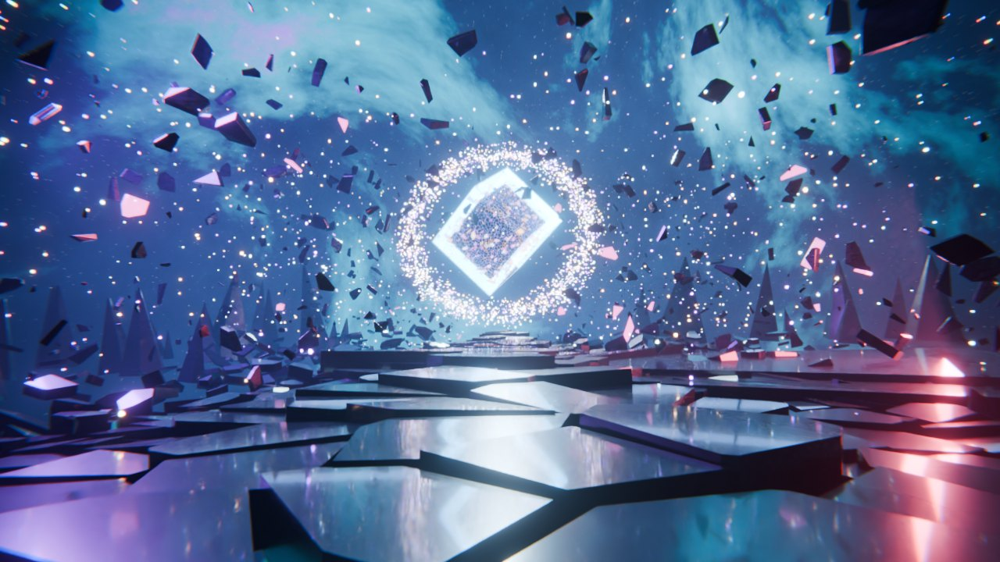
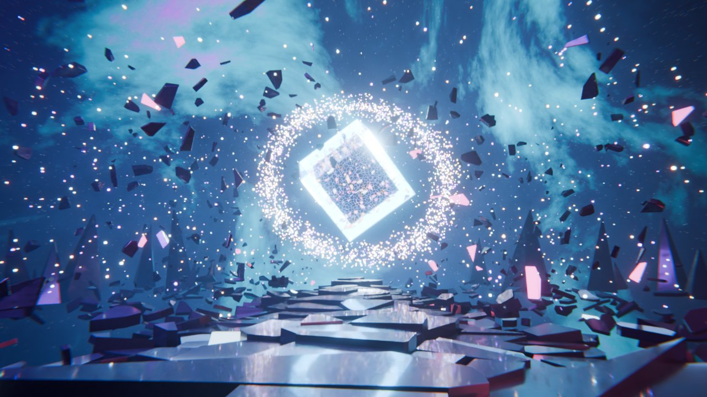
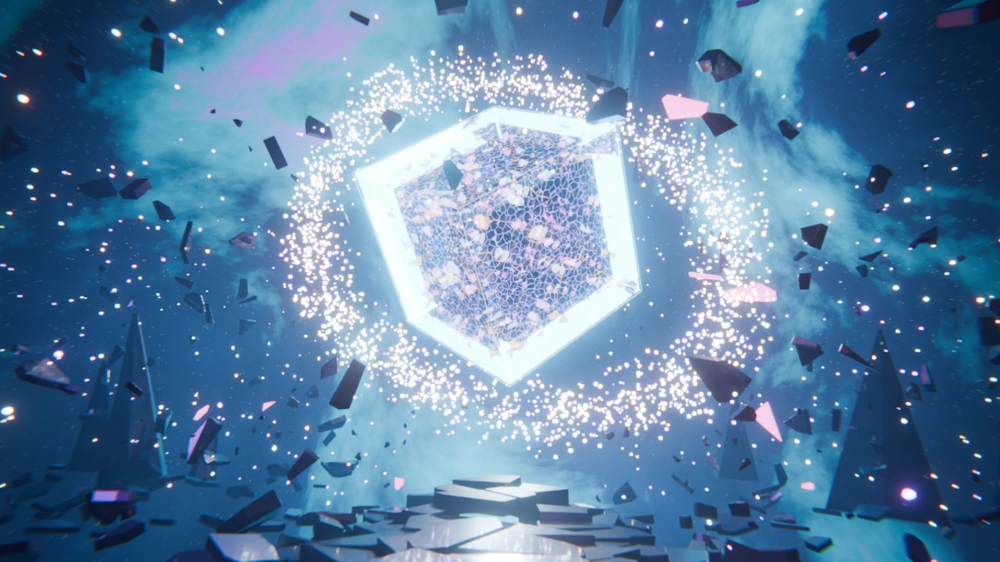
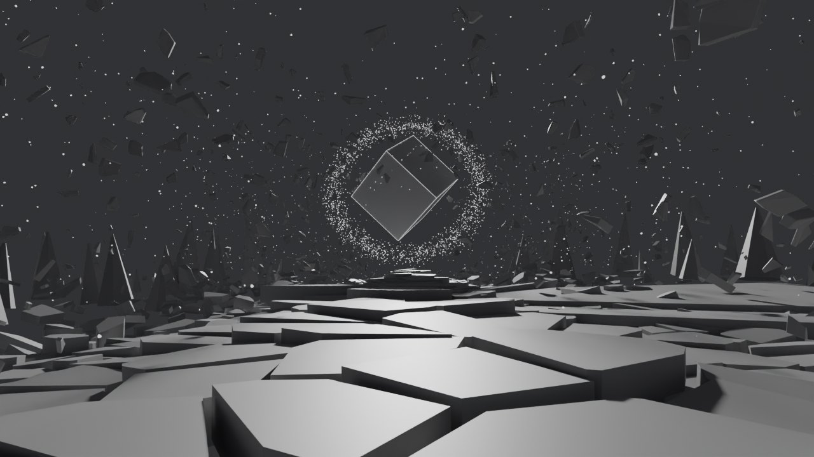

# 碎域 / Shattered Realm

把两份 Blender 5.0 教程手册（上篇《从碎裂地面到悬浮碎石》、下篇《科幻碎石场景：材质、灯光与粒子》）做成一个**一键生成的程序化场景**，并附一个浏览器实时版本。

| 第 1 帧 | 第 150 帧 |
|---|---|
|  |  |
| **第 300 帧** | **灰模（`--gray`）** |
|  |  |

以上四张图都由 `shattered_realm.py` 在 Blender 5.0.1（`bpy` 模块，Cycles CPU，1280×720，64 采样 + OIDN 降噪）实际渲染，每帧约 6–7 分钟（4 核 CPU）。

## 运行

```bash
# 只生成场景并保存工程
blender -b --python shattered_realm.py -- --save realm.blend

# 渲染单帧（粒子会自动从第 1 帧模拟到目标帧）
blender -b --python shattered_realm.py -- --render out.png --frame 150 --quality preview

# 正式动画（1920×1080，384 采样，有 GPU 自动用 GPU）
blender -b --python shattered_realm.py -- --render frames/ --animation --quality final

# 灰模，对照教程的阶段画面
blender -b --python shattered_realm.py -- --gray --render gray.png --frame 1
```

在 GUI 里：脚本工作区打开本文件并运行，会**新建**一个 `Shattered Realm` 场景，不会动你已有的场景。

参数：`--seed`、`--quality preview|final`、`--engine cycles|eevee`、`--gray`、`--frame`、`--resolution WxH`、`--samples`。

## 与教程的对照

### 上篇
| 手册章节 | 脚本里的实现 |
|---|---|
| 01 有厚度的地面 / 02 Cell Fracture | `voronoi_cells()`：纯 Python 二维 Voronoi（半平面裁剪），每个胞元挤出成石板。Cell Fracture 在 5.0 是要单独安装的扩展，无头模式不可靠，所以用等价算法代替。中央点稀（大块）、两侧点密（碎）。 |
| 03 抬起的碎石道路 | `build_ground()`：比例编辑的数学等价——沿中线的高斯衰减抬升；外侧按距离概率删除、缩小、倾斜、掀起。 |
| 04 镜头与两侧随机化 | 道路"前方宽、远端收束"（`road_half_width`）；相机 24mm 低机位。 |
| 05 实例集合 `pt 1` 与 `Cube.001` | 24 块碎片放进 `pt 1`（视图层排除，只被节点引用）；`Cube.001` 作体积容器，`scatter` 修改器直接挂在它上面。 |
| 06–08 几何节点 `scatter` | `build_scatter_group()`：网格转体积（体素数 64、内部带宽 0.2）→ 体积内分布点 → 实例化于点上（集合信息：分离子级、重置子级、选择实例）；随机值向量 × 值 → 旋转（0–4）；随机 0.1–1.3 → 缩放；噪波纹理（FBM、缩放 5、细节 2、粗糙度 0.5、间隙度 2）× 值 → 偏移。 |
| 09 300 帧线性推镜 + 立方体主体 | 线性插值关键帧（5.0 分层动作 API 变了，用"新关键帧默认插值"设置实现）。 |
| 10 环境光与体积雾 | `sunshine` 太阳光、`fog` 盒子用原理化体积接 **Volume** 插口。 |

### 下篇
| 手册操作 | 脚本里的实现 |
|---|---|
| 01/02/08 能量方块多层材质、冷暖色 | 外壳 `cube blue`：Voronoi 裂纹（色阶）→ 色相/饱和度/明度 → 冷暖混合，再与玻璃/透明混合（系数 0.5）；内层 `Cube.004` 金属度 0.918、粗糙度 0.05。原视频用的能量贴图没有随视频提供，这里是程序化代替。 |
| 03 体积雾 | 密度 = 光程「是否为摄像机射线」× 0.008（按本场景纵深缩小为 0.008×0.35），各向异性 0.264；额外乘了噪波团块与高度衰减。 |
| 04 星空背景 | 视频用 `BG.png` 贴在平面上；这里改为世界着色器里的程序化星云 + 银河带 + 星点，不会露边。 |
| 05 碎石漂移 | `scatter` 主层种子 1、旋转范围 0–4。 |
| 06 道路反射 + 关联材质 | 碎石材质里：光程 → 混合着色器系数，两路 BSDF（原理化 + 近镜面光泽）混合；所有碎片共用同一材质（相当于 Ctrl+L）。 |
| 07 面光源 | `lights` 集合里的 `Area.strip`：矩形 150 m × 1 m、2000 W、蓝色。 |
| 09 发光颗粒 `pt 2` | 三个低面数 Icosphere，自发光强度 30，用同一个 `scatter` 节点组散布（种子 2）。 |
| 10 圆环发射器 + 湍流 | `Torus Emitter` 粒子系统，渲染为集合 `pt 2`，随机尺寸 0.759；`Turbulence` 力场强度 5、尺寸 40、流动 0。 |
| 11/12 补光与色彩 | 红色补光 `Area.red`（视频提到"需要红色"）、紫色侧光、主体后方青色逆光。 |
| 后期 | 合成器：Bloom + Fog Glow + 轻微镜头色散 + 暗角。5.0 合成器改用 `scene.compositing_node_group` + 组输出节点，脚本对 4.x 留了兼容分支。 |

## 教程之外补上的东西

- **镜头走廊**：`scatter` 节点组多了 `Corridor` / `Corridor Top` 两个输入，删除视线通道里的点，碎石不会挡住道路和能量方块（下篇 05 的验收要求）。
- **容器缩放写进网格**：`make_container()` 直接生成指定尺寸的盒子。若像视频那样用物体缩放放大容器而不应用缩放，散布出来的碎片会被一起拉伸变形。
- **噪波随时间变化**：上篇手册里"时间驱动方式未辨认"，这里用 4D 噪波，W 接场景时间，碎石会缓慢漂移、自转。
- 场景尺度比视频大约 2–3 倍，所以几处密度按体积换算后调小，注释里都写了原值。

## 限制

- 只验证了 Cycles（CPU）。这台机器没有 GPU，EEVEE 在无头模式下没有产出图像，`--engine eevee` 未经验证。
- GUI 内运行的路径（新建场景、切换窗口场景）没有在带界面的 Blender 里实测。
- 手册说明其参数是"画面时点值、非最终值"，这里同样只作为起点。

## 实时网页版

`web/shattered-realm.html` 是同一场景的 Three.js 实时版本（同一套 Voronoi 碎地算法、体积散布、能量方块着色器、圆环粒子 + 湍流），可拖拽环视、拖时间轴、切换灰模/成片、调密度/漂移/湍流/辉光/雾。
